

#  BlindaLT 

> Visite o site: [BlindaLT - Landing Page](https://blindalt.vercel.app)

 

## Sobre o projeto

Landing page de apresentação para empresas de blindagem arquitetônica: portas, vidros e guaritas blindadas. A **BlindaLT** é uma marca fictícia, criada para mostrar o projeto funcionando de ponta a ponta. Nome, contatos, cidade e clientes são de exemplo e ficam concentrados em poucos arquivos, prontos para serem trocados pelos da empresa que adotar o site.

Em vez de só contar o que a empresa faz, a página mostra: logo na primeira rolagem uma mira trava no vidro da guarita e o visitante acompanha, em câmera lenta, um projétil ser destruído contra o vidro, que continua intacto. Depois vêm os serviços, o processo de trabalho, as obras já realizadas, os clientes atendidos e a área de atuação. Todos os caminhos levam ao WhatsApp ou ao e-mail da equipe de projetos.

O visual nasceu do próprio produto: o preto azulado da noite em uma portaria, o dourado do escudo e o tom esverdeado do vidro laminado.

 

## Prévia

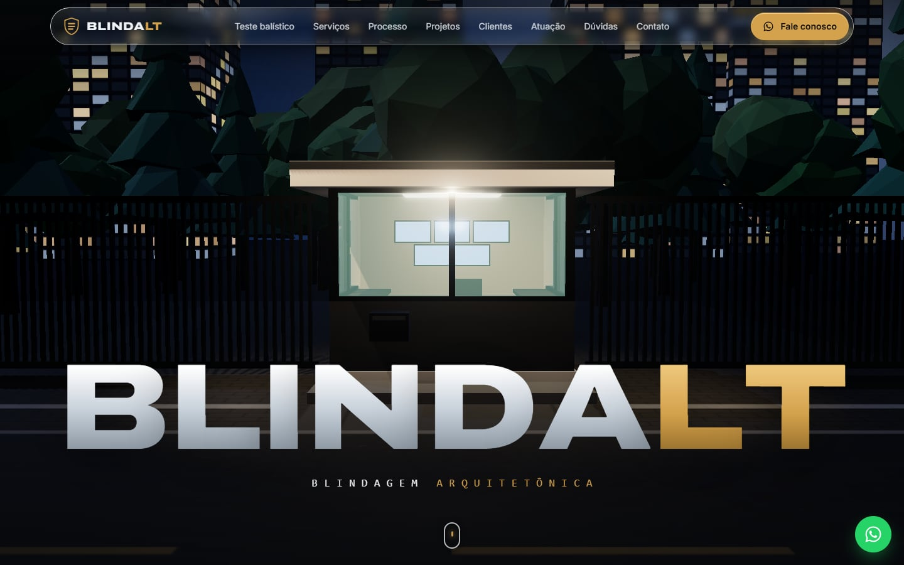

<table>
  <tr>
    <td width="50%">
      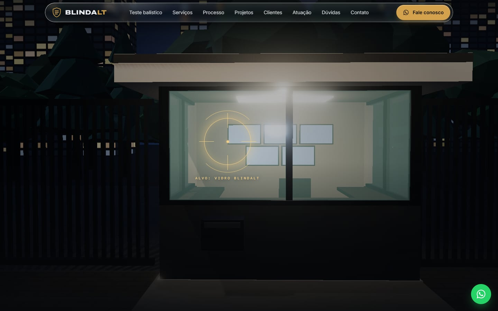
      
<b>A mira trava no alvo</b> Ao rolar, a câmera se aproxima e a mira gira até travar no vidro

    </td>
    <td width="50%">
      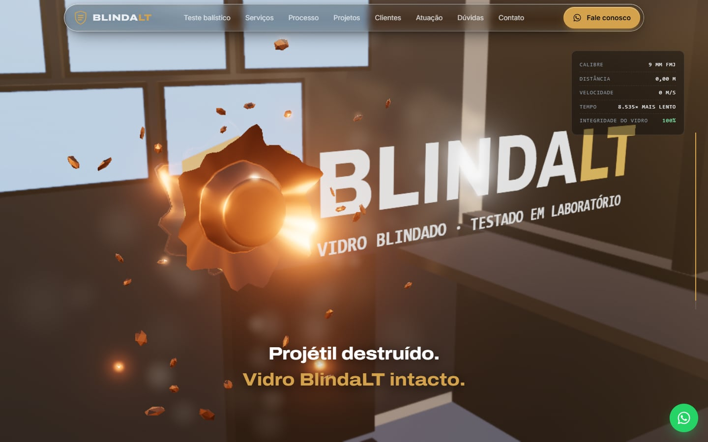
      
<b>Teste balístico</b> O projétil se deforma em câmera lenta e o vidro continua intacto

    </td>
  </tr>
  <tr>
    <td width="50%">
      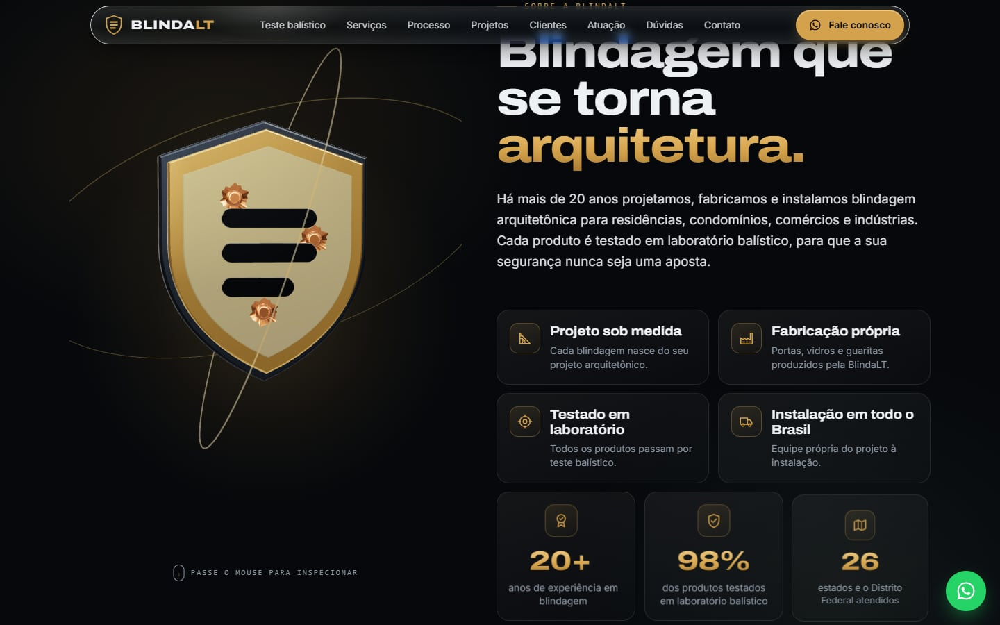
      
<b>Sobre a BlindaLT</b> Escudo 3D em camadas, diferenciais e números

    </td>
    <td width="50%">
      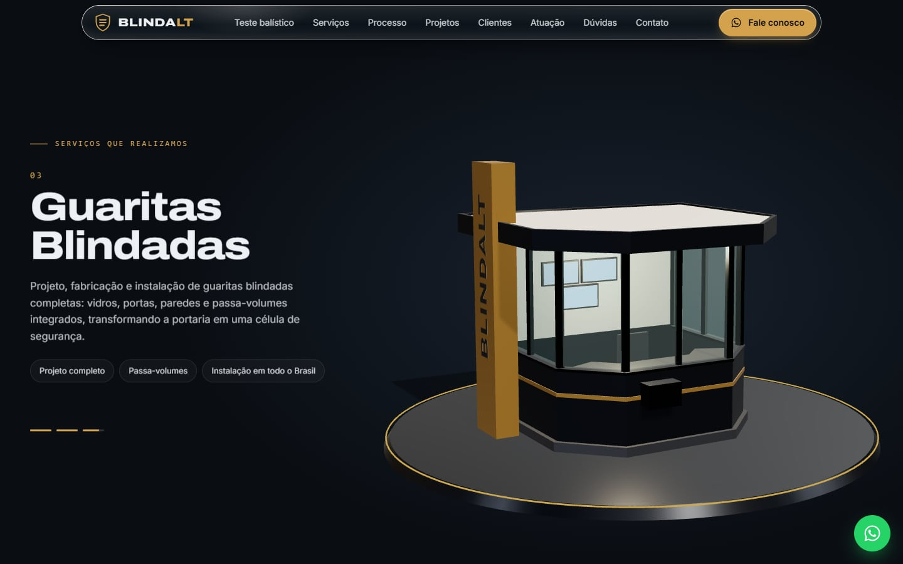
      
<b>Serviços</b> Portas, vidros e guaritas em uma vitrine 3D

    </td>
  </tr>
  <tr>
    <td width="50%">
      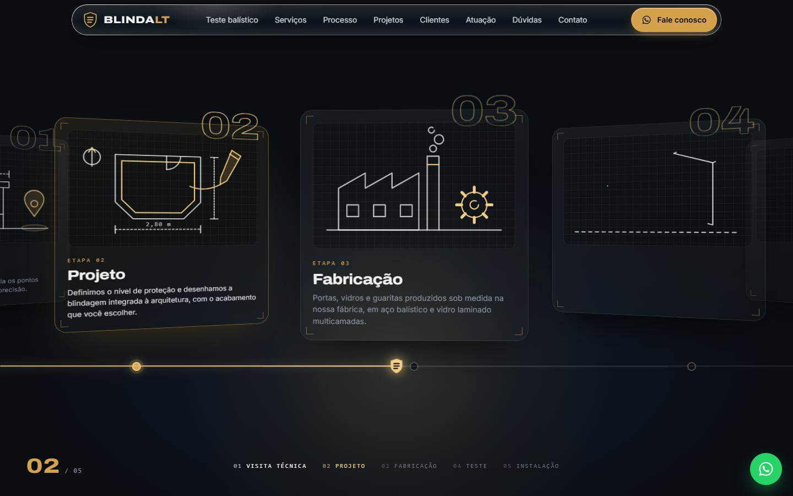
      
<b>Processo</b> Da visita técnica à instalação, em um trilho que se desenha com a rolagem

    </td>
    <td width="50%">
      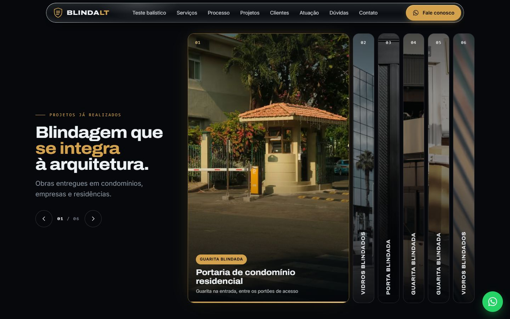
      
<b>Projetos já realizados</b> Fotos em uma galeria que se abre no hover, no toque ou pelas setas

    </td>
  </tr>
  <tr>
    <td width="50%">
      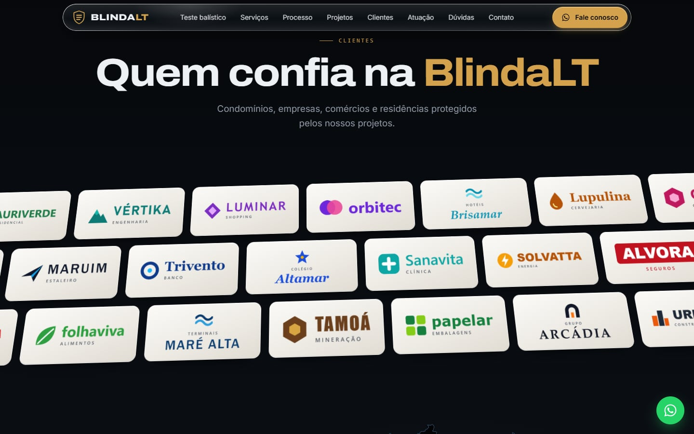
      
<b>Clientes</b> 30 marcas de exemplo em esteiras sobre um plano 3D

    </td>
    <td width="50%">
      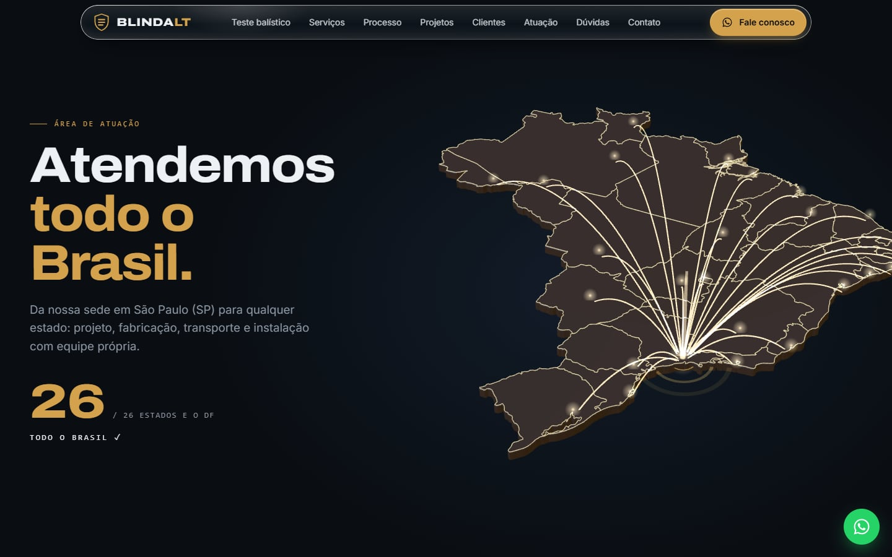
      
<b>Atendemos todo o Brasil</b> Mapa 3D com os 26 estados e o Distrito Federal ligados à sede

    </td>
  </tr>
  <tr>
    <td width="50%">
      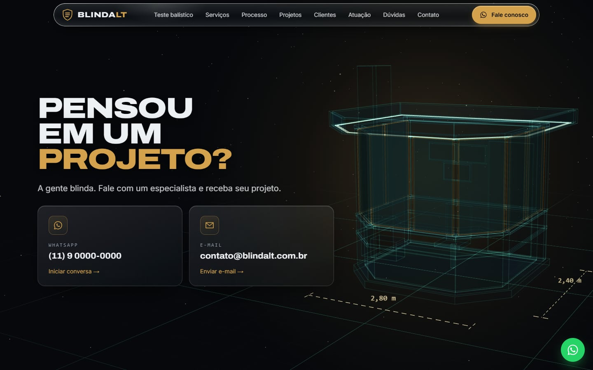
      
<b>Pensou em um projeto?</b> Planta holográfica da guarita e contato por WhatsApp ou e-mail

    </td>
    <td width="50%">
      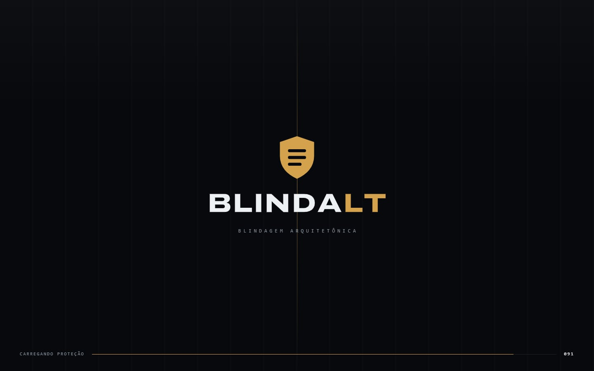
      
<b>Abertura animada</b> O escudo se desenha, resiste a um disparo e as portas blindadas se abrem

    </td>
  </tr>
</table>

### No celular

No celular a página recebeu o mesmo cuidado do computador: as cenas 3D foram reenquadradas para a tela em pé, o menu abre em tela cheia e o WhatsApp fica sempre a um toque.

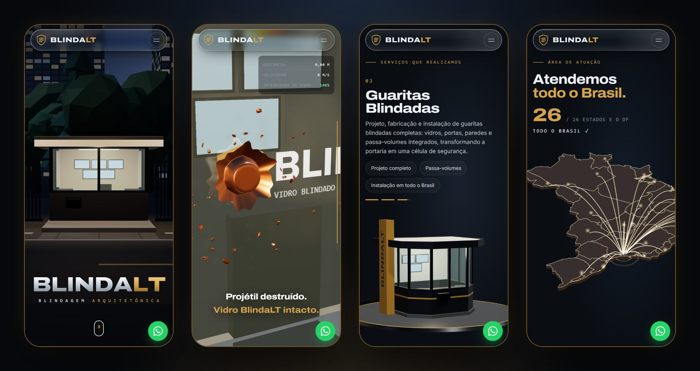

 

## Destaques

- **Teste balístico guiado pela rolagem**: uma cena 3D em que o projétil avança, entra em câmera lenta, achata contra o vidro e se desfaz. Rolando para cima, tudo acontece ao contrário, quadro a quadro.
- **Transição com mira**: ao sair do topo, a câmera se aproxima da guarita, a mira gira, trava no vidro e se abre em círculo para revelar o teste, sem corte.
- **Cenas 3D em tempo real**: portaria noturna, escudo em camadas, vitrine de serviços, mapa do Brasil e planta holográfica, todas desenhadas por código, sem vídeos nem modelos prontos.
- **Abertura animada**: o escudo se desenha, o nome sobe letra por letra, um projétil atinge o escudo e as portas blindadas se abrem. Em seguida a guarita é montada vidro a vidro.
- **Header de vidro**: uma cápsula flutuante que desfoca e refrata o que passa por trás. No celular, o menu se abre em círculo a partir do botão.
- **Detalhes que respondem ao mouse**: uma bala corta as palavras dos botões, os ícones se desenham sozinhos e os cartões inclinam em 3D. No celular, as mesmas animações acontecem no toque.
- **Contato em um toque**: WhatsApp com a mensagem pronta e e-mail da equipe de projetos, com um botão flutuante acompanhando a rolagem.
- **Responsiva**, sem rolagem lateral, do celular aos monitores largos. No iPhone, as telas fixas acompanham a barra do Safari.
- **Acessível**: respeita a preferência "reduzir movimento" do sistema, tem navegação por teclado, foco visível e texto alternativo em todas as imagens.
- **Pronta para o Google**: título principal descritivo, sitemap (com as fotos das obras), robots e dados estruturados da empresa, dos serviços e das perguntas frequentes.
- **Pronta para compartilhar**: ao enviar o link no WhatsApp ou nas redes sociais, a prévia mostra o topo do site. Tem favicon, ícone para a tela inicial do celular e manifesto.

 

## Identidade visual

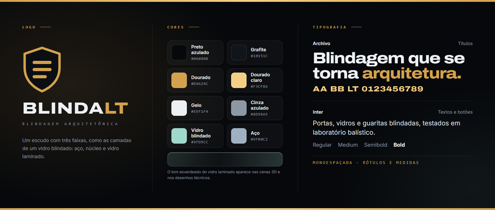

- **Logo**: um escudo com três faixas, como as camadas de um vidro blindado (aço, núcleo e vidro laminado), ao lado do nome com o "LT" em dourado. Foi desenhado para a landing page e pode ser trocado pelo logo da empresa.
- **Cores**: preto azulado e grafite no fundo, dourado nos destaques e gelo nos textos. O tom esverdeado do vidro laminado e o cinza do aço aparecem nas cenas 3D e nos desenhos técnicos.
- **Tipografia**: Archivo nos títulos, larga e pesada, com cara de placa de aço; Inter nos textos e botões; uma monoespaçada nos rótulos e nas medidas.

 

## Tecnologias

      

| Camada | Escolha |
| --- | --- |
| Framework | Next.js 16 (App Router), com a página gerada de forma estática |
| Interface | React 19 + TypeScript |
| Estilos | CSS Modules, sem frameworks de CSS |
| 3D | Three.js (WebGL), com cenas, texturas e modelos gerados por código |
| Animações | GSAP com ScrollTrigger e rolagem suave com Lenis |
| Imagens e fontes | `next/image` e `next/font` |
| Hospedagem | Vercel |

 

## Código-fonte

> [!NOTE]
> O código-fonte deste projeto é **privado**. Este repositório serve apenas como apresentação do trabalho.

 

## Direitos

A **BlindaLT** é uma marca fictícia: o nome, os contatos e os clientes exibidos foram criados para esta demonstração e não representam empresas reais. Qualquer semelhança com marcas existentes é coincidência. As fotos da galeria de projetos são ilustrativas, de banco de imagens de uso livre ([Unsplash](https://unsplash.com/license): Long Chung, Rahul Bhogal, Steel Doors, Mạnh Ngô, Tuaans e Declan Sun), e devem ser substituídas pelas das obras da empresa que adotar o site.

O projeto, o código e o design têm todos os direitos reservados: não é permitido reproduzir ou reutilizar este conteúdo sem autorização.

O contorno dos estados no mapa do Brasil vem de [@svg-maps/brazil](https://github.com/VictorCazanave/svg-maps) (CC BY 4.0).

<!-- Desenvolvido por: Guilherme Francisco Pereira-->
